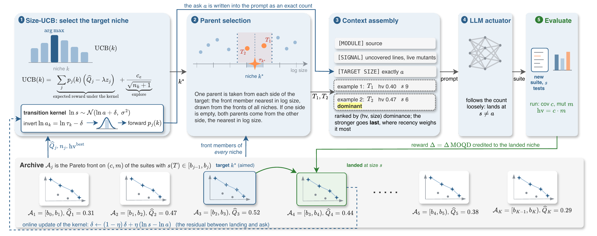

<h1 align="center">TeSearch</h1>

<p align="center">
  <b>Quality–diversity evolutionary search for test suites that are strong <i>and</i> small</b> —
  generates the executable improvement signal a self-evolving agent needs to decide
  which of its own rewrites to keep.
</p>

<p align="center">
  <a href="LICENSE"></a>
</p>

## What is TeSearch

TeSearch is a test-generation framework for module-level verification. Given a Python
module, it searches for a unit-test suite that maximizes coverage and mutation score
while using as few tests as possible. The delivered suite is the artifact: it runs on
every proposed rewrite of the module, so it has to be strong enough to catch a
behavior change and small enough to be worth running every time.

Suites are filed into **size niches**, and each niche keeps its own Pareto front over
coverage and mutation score, so a compact suite never has to out-score a large one to
survive. A **size-annealing bandit** decides which size the next LLM call should aim
for, favoring smaller suites once the module has reached decent quality. Since asking
a model for exactly *n* tests does not reliably produce *n* tests, a **landing kernel**
learns each module's size bias online and corrects the request before sending it.

## How it works

<p align="center">
  
</p>

1. **Opening generations.** Three suites are requested with no size named. Their sizes say what the model writes when left alone, and set where the niche grid is centred.
2. **The grid.** Niches are spaced by a constant ratio, since suite sizes compare multiplicatively. It spans from one test per public callable up to four niches above the opening sizes.
3. **Each call.** For every niche, the request that should land there is computed from the current size bias, along with the spread of niches it might land in instead. The bandit scores niches by what generations landing there have been worth, minus a penalty that grows with size once quality passes the gate, plus an exploration bonus.
4. **Breeding.** The two archived suites nearest the target size — one smaller, one larger — go into the prompt, weakest first, with a factual note on how they differ. The module source is annotated inline with what the strongest one still misses. The call is asked to compress or extend it to an exact test count.
5. **Filing.** The suite is run in the module's container. Failing tests are pruned, coverage and mutation are measured on what passes, and it joins the front of the niche its written size puts it in. The size bias and the niche's value are updated from what actually happened.
6. **Delivery.** Of every suite measured, the smallest among those tying for the best quality is handed back, and scored once against held-out mutants the search never saw.

## Installation

```bash
pip install -r requirements.txt       # or: pip install -e '.[dev]'
export OPENAI_API_KEY=sk-...          # plus OPENAI_BASE_URL for an OpenAI-compatible gateway
```

Requirements: Python 3.10+, Docker (each module runs inside its own TestGenEval
testbed image), and an OpenAI-compatible chat endpoint.

## Usage

### Quick start

The quick start runs two modules from TestGenEval-lite, listed in `data/subsets/demo2.txt`:

| Module | Testbed |
|---|---|
| `src/_pytest/mark/evaluate.py` | pytest 5.4 |
| `django/forms/boundfield.py` | django 4.0 |

```bash
scripts/fetch_data.sh                 # benchmark data, ~8 MB
scripts/pull_images.sh demo2          # 2 testbed images, ~1.5 GB

python scripts/run_tesearch.py --subset demo2 --jobs 2 --model gpt-5.4 --out runs/demo2
python scripts/report.py runs/demo2
```

Each module takes 40–70 minutes for the default 50 LLM calls; `--jobs 2` runs both at
once, one container each. An interrupted run resumes from its checkpoint: rerun the
same command and finished modules are skipped. To try a single module first, run
`--module pytest-dev__pytest-7373 --budget 10`.

| Flag | Default | Meaning |
|---|---|---|
| `--module` / `--subset` / `--all` | — | One module (instance id, module id or dotted path), a list in `data/subsets/`, or the whole split |
| `--model` | `gpt-5.4` | LLM backbone, any model name the endpoint accepts |
| `--budget` | `50` | LLM calls per module, opening generations included |
| `--config` | `configs/default.yaml` | Every other search knob (see below) |
| `--jobs` | `1` | Modules run in parallel, one container each |
| `--out` | `runs/lite` | Output directory, one subdirectory per module |
| `--list` | — | Print the selected modules and their images, then exit |
| `--no-resume` | — | Start over instead of resuming from `state.json` |

### Configuration

Defaults for every search knob live in `configs/default.yaml`; `--model` and
`--budget` override it per run.

| Key | Default | Role |
|---|---|---|
| `sigma` | `0.10` | Landing spread in log units; also sets the niche ratio `exp(2·sigma)` |
| `eta` | `0.2` | LMS step for the per-module size bias |
| `alpha_q` | `0.3` | Smoothing rate of a niche's value estimate |
| `c_e` | `0.5` | Weight of the exploration bonus |
| `H` | `0.85` | Quality gate: size pressure starts once the best hypervolume exceeds it |
| `gamma` | `4` | Niches the grid extends above the seed anchor |
| `n_seed` | `3` | Opening generations made without naming a size |
| `search_mutants` / `eval_mutants` | `60` / `800` | Mutants that score the search / the delivered suite |

The prompts are plain text under `prompts/`: the opening-generation system prompt,
the two breeding system prompts (compression and extension), and the fragments the
user prompt is assembled from. Edit them there; the code reads them verbatim.

### Outputs

Per module, under the output directory:

| File | Contents |
|---|---|
| `result.json` | The delivered suite's coverage, mutation score and hypervolume on the search mutants and on the held-out ones, its size, and the run's MOQD and wall time |
| `delivered_suite.py` | The suite the run hands back |
| `events.jsonl` | One record per call: the niche aimed at, the size requested, where the suite landed, the reward, the learned size bias, the size pressure, tokens and timings |
| `llm_io.jsonl` | Every prompt and reply in full, with token counts |
| `suites/call_NNN.py`, `.green.py`, `.json` | Each generated suite, its passing subset, and its measurement (failing tests, uncovered lines, surviving mutants) |
| `state.json` | The checkpoint a resumed run reads |

`scripts/report.py` prints one row per module plus the mean: `cov`, `mut` and `hv` of
the delivered suite on the search mutants and on the held-out ones (`eval_*`), its
size, the largest suite the search tried, and `seed_hv`, the best of the opening
generations, so the gap to `hv` is what searching added. `--csv` writes the same
table to a file.

### Results without running anything

`example_run/` holds a completed run of both quick-start modules: every prompt and
reply, every generated suite, and the measurements. Read it with the same script:

```bash
python scripts/report.py example_run
```

|  | delivered tests | coverage | mutation | largest suite tried | held-out hv |
|---|---|---|---|---|---|
| `_pytest/mark/evaluate.py` | 7 | 1.000 | 1.000 | 102 | 0.972 |
| `django/forms/boundfield.py` | 21 | 1.000 | 1.000 | 124 | 1.000 |

Nine suites reached top quality on the first module and fifteen on the second,
ranging from 7 to 87 and from 21 to 79 tests. Because every one of them is kept in its
own size niche, delivery can hand back the smallest rather than whichever one happened
to be found last.

## Benchmark

`scripts/fetch_data.sh` downloads the TestGenEval-lite split into
`data/testgenevallite/` and writes `data/modules_lite.jsonl`: 160 instances covering
129 distinct modules from django, sympy, scikit-learn, matplotlib, pytest and others,
each pinned to a release and paired with a containerized testbed image. Rows are
grouped by module, since a run targets a module rather than a commit; the
repository's own tests are never shown to the model.

The benchmark is [TestGenEval](https://github.com/facebookresearch/testgeneval)
(Jain et al., 2024), released under CC BY-NC 4.0. It is downloaded rather than
redistributed here, and its license governs the downloaded data.

### Measurement

Each module runs in one container built from its own testbed image, started once and
reused; the search itself only produces text, and nothing from the repository under
test is imported on the host. Mutants are generated once per module and split into
two disjoint sets: 60 that score the search, and the rest, held out, used only on the
delivered suite. A suite is measured twice over: as written, for its size and pass
rate, and as its passing subset, for coverage and mutation, because a test that fails
on the unmutated module would otherwise "kill" every mutant it touches.

## Repository layout

| Path | What it does |
|---|---|
| `src/tesearch/grid.py` | lays out the size niches from the opening generations |
| `src/tesearch/kernel.py` | turns a target size into a request, and predicts where it lands |
| `src/tesearch/archive.py` | keeps a Pareto front per niche and scores the collection |
| `src/tesearch/ucb.py` | picks the niche each call aims at, and when to start favoring small |
| `src/tesearch/parents.py` | chooses, orders and labels the example suites for a prompt |
| `src/tesearch/prompts.py` | assembles the prompts from `prompts/` and marks gaps inline in the source |
| `src/tesearch/search.py` | the run loop, its event log, checkpoints and delivery |
| `src/tesearch/harness/` | containers, mutant generation, measurement, LLM client |
| `src/tesearch/data.py` | the benchmark modules and everything needed to rebuild them |
| `configs/default.yaml` | all tunables in one place |
| `prompts/` | the system prompts and user-prompt fragments, verbatim |
| `scripts/` | `run_tesearch.py`, `report.py`, `fetch_data.sh`, `pull_images.sh` |
| `tests/` | 45 offline tests; a fake model and a fake measurer drive the whole loop |

```bash
python -m pytest        # no Docker or API key needed
```

## Citation

If you use TeSearch in your research, please cite:

```bibtex
@inproceedings{cheng2026tesearch,
  title     = {Small but Mighty: Test Suites as Improvement Signals for Self-Evolving Agents},
  author    = {Cheng, Yutong and Cheng, Wei and Yu, Wenchao and Zhou, Dawei and Chen, Haifeng},
  booktitle = {NeurIPS 2026 Workshop on Self-Evolving Diversity-Driven Search for Robust AI Systems (EvoRobust)},
  year      = {2026}
}
```

## License

MIT (see `LICENSE`). The TestGenEval data that `scripts/fetch_data.sh` downloads
keeps its own CC BY-NC 4.0 license.
